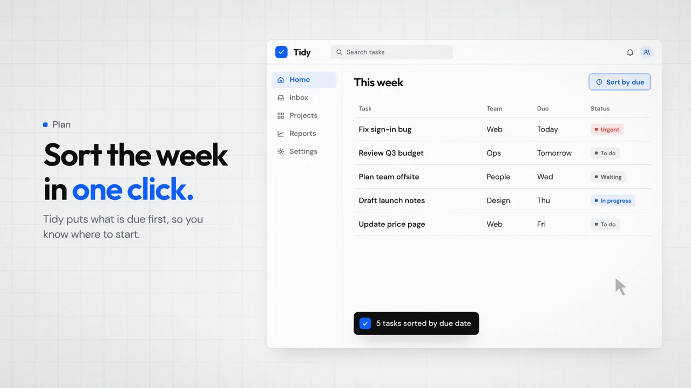
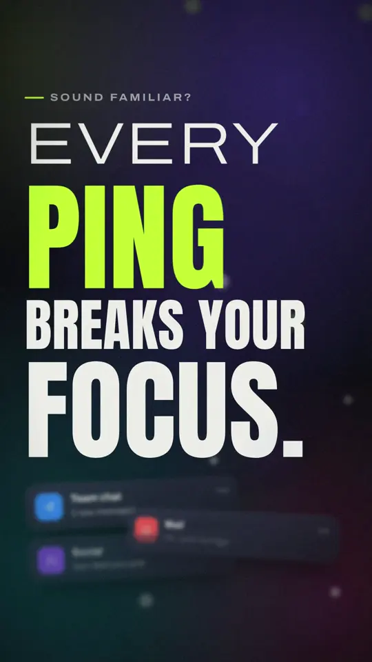

<h1 align="center">Easy Video</h1>

<p align="center"><b>Make professional product videos and reels with Claude — no skills needed.</b></p>

> **This is the open-source, generic version of the Ustad Billu channel's video skill.
> Free to use for everything — no credit needed. Free and open source.**

<p align="center">
  
  &nbsp;
  
</p>

<p align="center"><sub>A lightweight version of my own video skill.</sub></p>

You don't need to know video editing, design or code. You chat with Claude,
answer a few simple questions, and get a finished video file you can post.

## Quick start (3 steps)

1. **Install Claude.** Get the Claude desktop app or Claude Code:
   [claude.com/claude-code](https://claude.com/claude-code)
2. **Paste this message to Claude:**

   ```
   Make me a video using https://github.com/Faizanahmedsy/easy-video-skill
   ```

3. **Answer a few simple questions.** Claude does the rest and tells you
   when your video is ready.

That's it.

## What you can make

| | Shape | Good for |
|---|---|---|
| **Product video** | Wide (16:9) | Your website, YouTube, LinkedIn, a launch post |
| **Reel** | Tall (9:16) | Instagram Reels, TikTok, YouTube Shorts |

Both work **with a voice** (a free AI voice you make in a few clicks) or
**without a voice** (words on screen with music). Music and sound effects
are made for you, so they are free to use.

## How it works

1. **A few questions.** What it is, what it does, and how long the video
   should be. Every question has a sensible default.
2. **A short script.** Claude writes it from your answers. Change any line
   you like.
3. **A free AI voice (optional).** Claude shows you, click by click, how to
   make the voice in Google AI Studio. Or skip it and use words on screen.
4. **A draft to check.** A quick preview of the whole video. Say "looks
   good" or tell Claude what to change, in your own words.
5. **The final video.** The full-quality version, ready to post.
6. **Post it.** Claude tells you where the file is and how to post it.

Claude tells you how long each wait will be before it starts.

## Questions

**How much does it cost?**
Nothing. This is free. You only need Claude. The AI voice is free too:
you make it in Google AI Studio with a Google account.

**How long does it take?**
About 15 to 30 minutes from start to finish, most of it the computer
working on its own. The first time takes a few extra minutes to set up.

**Can I change things?**
Yes. Change the script, the colours, the words on screen or the length.
Just tell Claude what you want, like "make the second part slower" or "use
my blue".

**My computer is slow. Will it work?**
Yes, it just takes longer. The draft is a smaller, faster version, so you
can check the video before the long final step. Close other big apps while
it works.

**Does it work on Windows?**
Yes, through WSL (a free Windows feature that runs Linux tools). Claude can
set it up for you. Mac and Linux work out of the box.

**Can I use the video for my business?**
Yes, for anything, with no credit needed.

**Do my files leave my computer?**
The video is made on your computer. If you choose a voice, only the script
you paste goes to Google AI Studio.

## For Claude: start here

1. Clone this repo into your skills folder, so it works next time too:

   ```bash
   git clone https://github.com/Faizanahmedsy/easy-video-skill ~/.claude/skills/easy-video
   cd ~/.claude/skills/easy-video
   ```

2. Run the setup once (it installs everything it needs, and tells you if
   something is missing):

   ```bash
   bash scripts/setup.sh
   ```

3. Read [`SKILL.md`](SKILL.md) and follow it step by step. The person you
   are helping may never have made a video, so use plain words.

More for Claude: [`CLAUDE.md`](CLAUDE.md), [`docs/kit.md`](docs/kit.md),
[`docs/voice.md`](docs/voice.md), and the two examples in
[`examples/`](examples/).

---

Made by **Faizanahmed Saiyed**. License: [MIT-0](LICENSE) (use it for
anything, no credit needed). Fonts are under the SIL Open Font License; see
each folder in [`fonts/`](fonts/).
