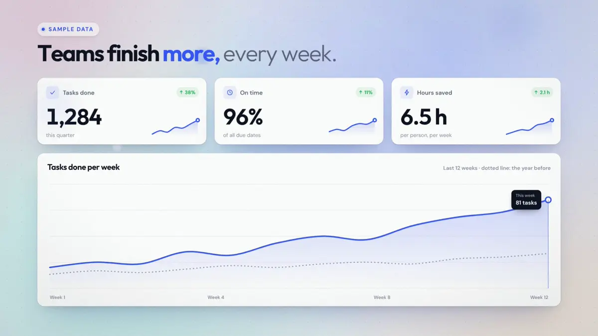

# Example: product video (Clean)

A 18.5-second, 16:9 video for a made-up task app called Tidy, in the **Clean** look.
No voice: music and on-screen text. All data is dummy data.

- `config.js`: size, length, look
- `scenes.js`: the six shots
- `script.md`: what is on screen, and when

Try it from the skill folder:

```
node engine/render.mjs examples/product-video --stills 6   # a few pictures
node engine/render.mjs examples/product-video --draft      # a quick draft video
```


