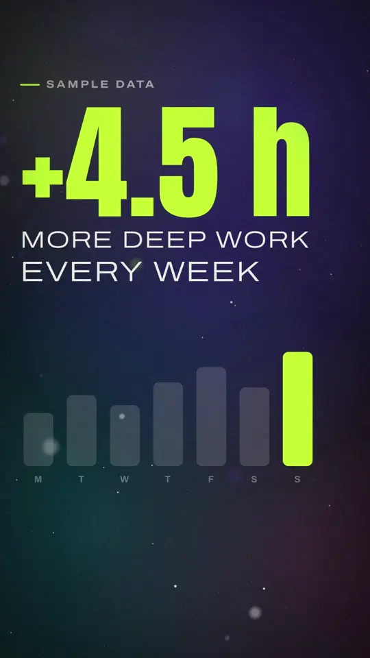

# Example: reel (Bold)

A 14-second, 9:16 reel for a made-up focus app called Hush, in the **Bold** look.
No voice: music and big type. Every number on screen is sample data.

- `config.js`: size, length, look, backdrop
- `scenes.js`: the shots
- `script.md`: what is on screen, and when

Try it from the skill folder:

```
node engine/render.mjs examples/reel --stills 6   # a few pictures
node engine/render.mjs examples/reel --check      # the layout check
node engine/render.mjs examples/reel --draft      # a quick draft video
```


