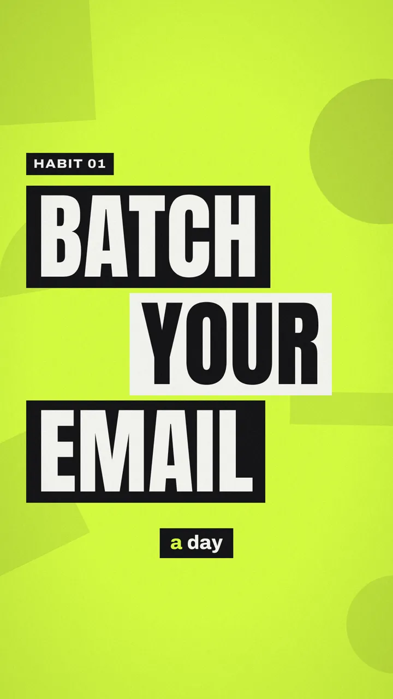

# Bold

A loud duotone look for reels. 9:16 first; works in 16:9.

- Near-black `#0F0F12`, acid lime `#D6FF3D`, off-white `#F7F7F2`
- Anton, uppercase, huge, fitted to the safe width; Archivo for labels and captions
- Text on solid blocks that slide in and stack from alternating sides
- A solid full-frame ground per shot, with geometric blocks drifting in the back plane
- Captions on a black block, the spoken word in lime

## Helpers

`const L = Kit.use(v, "bold")`, then (colours by name: `"black"`, `"lime"`, `"white"`):

| Call | What it makes |
| --- | --- |
| `L.shot(name, ground)` | a scene with a solid ground in its own plane (pushes carry it) |
| `L.shapes(A, { at, dur, seed, land })` | drifting squares, discs, half-discs and bars; `land: true` drifts them into place |
| `L.stack(parent, [{ text, bg }], { x, y, w, at, max })` | lines on blocks, each fitted to the width, from alternating sides |
| `L.unstack(S, at)` | the blocks leave the way they came |
| `L.block(parent, text, { x, y, w, bg, from, at })` | one block of text |
| `L.label(parent, text, { x, y, bg, at })` | a small Archivo label on a block |
| `L.count(parent, { y, from, to, at, fmt, color })` | a big count-up fitted to the width |
| `L.words(text, at, each)` | word times for captions when there is no voice |
| `L.captions(parent, { words, y, from, to })` | captions on a black block (voice words by default) |

## Transitions

- `L.panels(at, { colors })`: lime, black and white panels stack upward; swap shots at `.mid`
- `L.push(A, B, at)`: push up (or `dir: "left"`)
- `L.zoomThrough(A, B, at, x, y)`: dive into a block
- `L.cut(A, B, at)`: a hard cut with a 2-frame lime flash

To loop, build the opening shot again at the end so the last frame matches the first
(see `examples/reel`).
