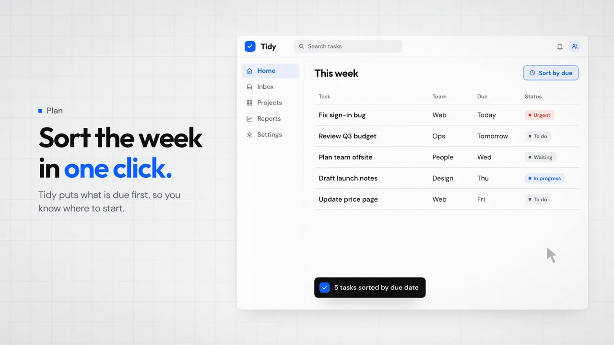

# Clean

A light studio look for product videos. 16:9 first; works in 9:16 and 1:1.

- A pale ground `#F0F2F6` lit by slow, soft pools of coloured light and a faint dot grid
  (`backdrop: "glow dots"` in config.js)
- White cards with layered soft shadows, 22 px corners; app windows rise and untilt in 3D
- Ink `#0B1020`, muted `#5A6378`, ONE accent: cobalt `#2E5CFF`; gain `#12A150`, loss `#E0463A`
- Outfit for headlines and figures, with a light second voice (`^quiet words^`); DM Sans for interface text
- Every shot has depth: three planes, out-of-focus discs behind and in front, a slow camera drift

## Helpers

`const L = Kit.use(v, "clean")`, then:

| Call | What it makes |
| --- | --- |
| `L.shot(name)` | a scene with three depth planes (`A.P.bg / mid / fg`) and soft discs for depth |
| `A.P.drift(at, dur)` | the slow camera every shot should have (from the kit) |
| `L.eyebrow(parent, text, { x, y, at })` | a small uppercase label in a pill |
| `L.title(parent, "Line one\|^quiet line^", { x, y, size, w, align })` | a headline; `*word*` is the accent |
| `L.reveal(t, at)` | the title's entrance: word by word out of a mask |
| `L.text(parent, text, { x, y, w, at })` | a line of muted body text |
| `L.logo(parent, { size, name })`, `L.logoIn(logo, at)` | the product mark and name; the mark lands, the check draws |
| `L.app(parent, { x, y, w, h, name, nav, active, search, at })` | an app window: lights, logo, search, team faces, left nav; returns `body` and its stage `box` |
| `L.heading`, `L.tabs`, `L.button`, `L.press`, `L.chip`, `L.face` | parts for inside the app |
| `L.tasks(parent, { x, y, w, rows, at, sortAt, sortBy })` | a task table (owner faces, due chips, progress bars) that slides in, re-sorts; `.tick(row, at)`, `.light(row, at)` |
| `L.kpis(parent, items, { x, y, w, h, at })` | number tiles: icon, rolling number, change chip, sparkline |
| `L.chart(parent, { x, y, w, h, title, values, compare, at, tag, labels })` | a line chart card with a dotted grid, a quiet comparison line and a value tag |
| `L.assistant(parent, { w })` | an assistant side panel: `.ask(at, text)`, `.answer(at, text)`, `.steps(at, list)` |
| `L.toast(parent, text, { x, y, at, out })` | a toast that slides up and leaves |
| `L.snippet(parent, { x, y, icon, color, title, sub, time, badge })` | a card from another app (mail, chat, a doc) |
| `L.flyTo(el, target, at)` | a match cut: one thing flies onto another and becomes it |
| `L.endCard(A, { name, tagline, cta, url, at, click })` | logo, tagline, a button with a sheen, a cursor click |
| `L.cursor(A.P.fg.g)` | a cursor: `.glide`, `.click`, `.leave` |

## Transitions

- `L.whip(A, B, at)`: a fast pan to the next shot, streaked by motion blur
- `L.push(A, B, at, { dir })`: slide to the next shot, near planes faster than far ones
- `L.zoomThrough(A, B, at, x, y)`: dive into a point of the old shot
- `L.wipe(at)`: a curved cobalt wave crosses the frame; swap shots at `.mid`
- `L.panels(at)`: ink and cobalt panels sweep across; swap shots at `.mid`

See `examples/product-video` for all of these in one video.
